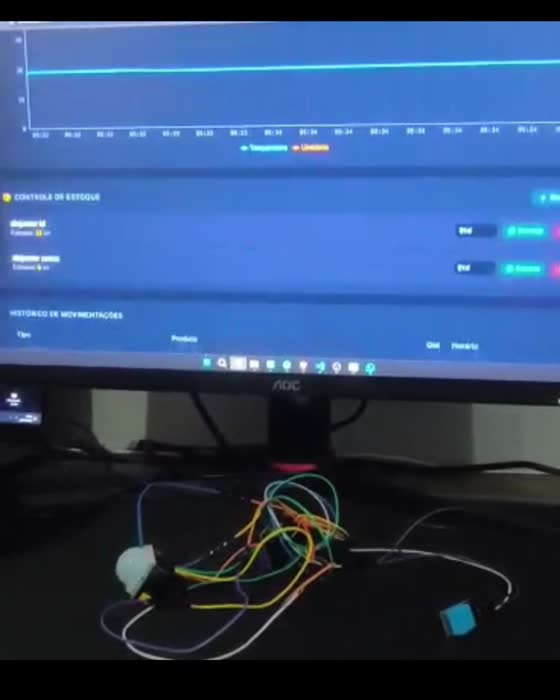

# Hardware Firmware Inventory Bridge

Software, hardware and firmware integration based on `Video Project 4 (1).mp4`: an ESP32 sensor node, native C++20 serial gateway, local dashboard and inventory ledger.

## Capabilities

- DHT acquisition, filtered measurements, PIR debouncing and presence LED.
- CRC-protected binary telemetry and sequence validation.
- Local HTTP dashboard with temperature history, humidity, presence and stock quantities.
- Read-only JSON API, stale device detection and bounded client handling.
- Idempotent stock movements, negative balance prevention and ordered audit events.
- Repository boundary for future transactional persistence.

PIR presence is independent from stock: it cannot identify products or count withdrawals. Inventory movements are entered explicitly through the local terminal.

## Build and run

Linux, GCC 12 or newer, GNU Make and a connected ESP32.

```sh
make all test
./build/bridge /dev/ttyUSB0 8080
```

Open `http://127.0.0.1:8080`. Enter movements in the bridge terminal:

```text
move cable 24 delivery-1
move cable -2 withdrawal-1
move breaker 10 delivery-2
```

Repeating the same key and payload returns the original movement. Reusing the key with a different payload is rejected. `GET /api/status` returns telemetry and inventory. The server binds only to loopback; it is a local lab interface. A serial disconnect requires restarting the bridge.

## Firmware and hardware

Sketch: `firmware/inventory_node/inventory_node.ino`.

```sh
arduino-cli core update-index --additional-urls https://espressif.github.io/arduino-esp32/package_esp32_index.json
arduino-cli core install esp32:esp32 --additional-urls https://espressif.github.io/arduino-esp32/package_esp32_index.json
arduino-cli lib install "DHT sensor library" "Adafruit Unified Sensor"
make firmware
arduino-cli upload --fqbn esp32:esp32:esp32 --port /dev/ttyUSB0 firmware/inventory_node
```

Defaults: ESP32 Dev Module, DHT11 GPIO 4, PIR GPIO 27 and onboard LED GPIO 2. Adjust these for the actual hardware. See [docs/hardware.md](docs/hardware.md) and [docs/protocol.md](docs/protocol.md). Official setup references: [Arduino CLI](https://arduino.github.io/arduino-cli/latest/) and [Espressif Arduino installation](https://docs.espressif.com/projects/arduino-esp32/en/latest/installing.html).

## Storage and validation

Inventory and telemetry are held in memory and reset on process restart. No database, credentials or cloud backend are included. Adapter structure: [docs/persistence.md](docs/persistence.md).

Tests cover movement idempotency, conflicting keys, insufficient stock, commit failures and packet integrity. A pseudo-terminal integration check exercised serial frames, the HTTP API and stock updates. Board compilation and physical hardware validation remain separate: [docs/validation.md](docs/validation.md).

## Video evidence

[](https://github.com/brunnojob/hardware-firmware-inventory-bridge/releases/tag/reference-demo)

[Open the original demonstration](https://github.com/brunnojob/hardware-firmware-inventory-bridge/releases/tag/reference-demo)

The original video shows the author's physical hardware and reference software. This repository supplies a new native implementation and wiring contract, without the database shown in the recording. The recording is not a test run of this code. Original filename and SHA-256: [evidence/provenance.json](evidence/provenance.json).

## Credits and license

Created for [brunnodev.store](https://brunnodev.store/). MIT: [LICENSE](LICENSE).
